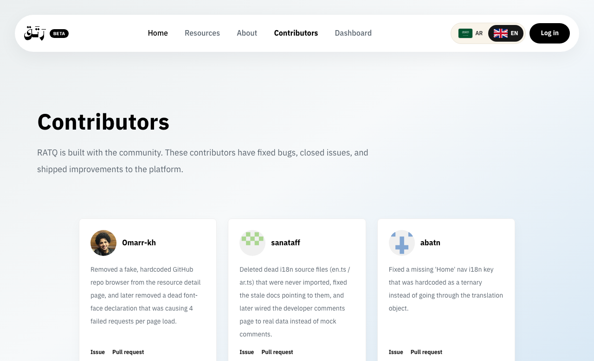

# RATQ Community Platform | منصة مجتمع رتق

> **اكتشف بثقة. ابنِ بإتقان. شارك بمسؤولية.**
> The directory and distribution hub for Quranic software resources.

Production: https://ratq.itqan.dev · Beta: https://beta.ratq.itqan.dev

## Stack
- **App:** Next.js 15 serving a client-side `react-router-dom` app (`app/[[...slug]]` catch-all, routes in `src/router.tsx`), React 18, TypeScript, Tailwind CSS 3, RTL-first, `i18next` (Arabic default, English).
- **State/data:** TanStack Query, Zustand.
- **Backend:** the Payload CMS API in `payload-backend/` (Users, Resources, Comments, AccessRequests, APIKeys, Reports, Notifications, Announcements). The frontend only calls its REST API; no other backend.
- **Hosting:** Cloudflare Worker via OpenNext (`wrangler.jsonc`). The API is deployed separately (see `.github/workflows/deploy-backend.yml`).
- **Tests:** Vitest + Testing Library (unit), Playwright (`e2e/`).

## Live data vs Demo
`NEXT_PUBLIC_PAYLOAD_API_URL` is read **at build time**.

- **Set** (production, beta): live mode. Resources, auth, comments, access requests, API keys, reports and notifications use the real API. Pages with no backend yet are marked **Demo / تجريبي** in the nav and run on in-memory mock data.
- **Unset** (default local build): everything runs on mock data, no backend needed.

`PORTING.md` maps every live route to its page; `MOCKED.md` lists the Demo-only pages that still need a backend.

## Local development
Requires Node 20+ and pnpm 10+.

```bash
pnpm install
pnpm dev                       # mock mode, http://localhost:3000
```

To develop against a local Payload, start `payload-backend/` (see its README; its dev server also uses port 3000) and run the frontend on another port:

```bash
NEXT_PUBLIC_PAYLOAD_API_URL=http://localhost:3000/api pnpm exec next dev -p 3100
```

The production API only allows the `ratq.itqan.dev` and `beta.ratq.itqan.dev` origins, so localhost cannot call it.

## Checks
```bash
pnpm typecheck
pnpm test                      # Vitest
pnpm cf:build                  # OpenNext build (what CI and deploy run)
pnpm test:e2e                  # Playwright against beta (BASE_URL overrides)
```

`pnpm test:e2e` runs read-only specs by default. The sign-in spec needs a throwaway account in `E2E_EMAIL` / `E2E_PASSWORD` and is skipped without them. Never use a real user.

## Deploy
```bash
NEXT_PUBLIC_PAYLOAD_API_URL=https://api.ratq.itqan.dev/api pnpm cf:deploy
```
Needs `wrangler` authenticated to the Cloudflare account in `wrangler.jsonc`.

## Contributing
See [CONTRIBUTING.md](CONTRIBUTING.md) and our [CODE_OF_CONDUCT.md](CODE_OF_CONDUCT.md). Features marked Demo are the best places to start. All contributions target the `main` branch.

Every merged contribution gets a shoutout on the [Contributors page](https://ratq.itqan.dev/contributors) and the community's [Hall of Fame](https://community.itqan.dev/d/658). Pick up a [good first issue](https://github.com/Itqan-community/RATQ/issues?q=is%3Aissue+is%3Aopen+label%3A%22good+first+issue%22) and join them.



## Docs
- [RATQ Community Platform overview](./docs/RATQ%20Community%20Platform.md): strategic overview and roadmap.

## Community
Questions or design discussions: [GitHub Discussions](https://github.com/Itqan-community/RATQ/discussions). Notable changes are in [CHANGELOG.md](CHANGELOG.md).

## Governance and integrity
Content rules for Quranic text are in [DECISIONS.md](DECISIONS.md), [GOVERNANCE.md](GOVERNANCE.md) and [SECURITY.md](SECURITY.md).

## License
[MIT](./LICENSE)
